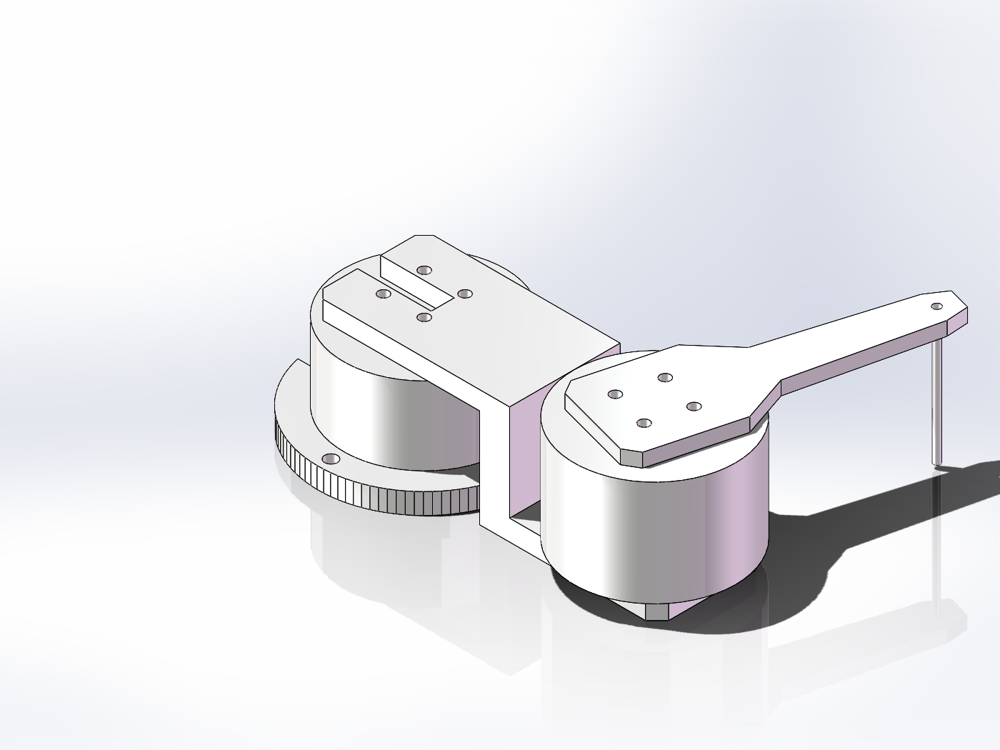
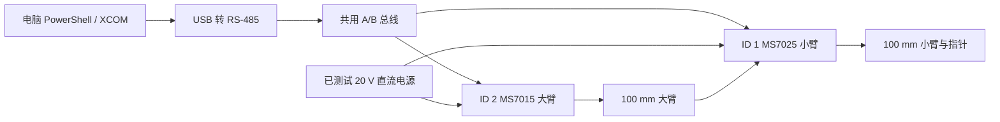

# 双无刷电机实现的FOC二连杆定位

使用 K-TECH MS7015 V1 和 MS7025 V1 两台低速直驱无刷伺服电机，完成旧电机恢复、RS-485 通信、平面二连杆结构设计、逆运动学定位、坐标标定和 FOC 原理学习。资料整理日期为 2026-11-26。

**当前已完成两轴通信、正反转、限速位置运动和输入 XY 坐标的二连杆定位。FOC 电流闭环实现仍待核实和开发。** 原装驱动板内部固件未开放，本项目提供的程序为上位机串口及运动学脚本。老 RMD-S 手册称该系列使用 FOC，实物的相电流采样及 Id/Iq 闭环能力尚未确认。



## 系统组成

| 项目 | 本机配置 |
|---|---|
| 肩关节 / 大臂 | MS7015 V1，RS-485 ID 2 |
| 肘关节 / 小臂 | MS7025 V1，RS-485 ID 1 |
| 两段有效杆长 | 各 100 mm |
| 原装驱动板 | GYEMS RMD-S 70/90 V1.2.1，两台布局一致 |
| 已识别反馈器件 | MS7025 板上 AS5600，12 位单圈磁编码器 |
| 已测试供电 | RXN-605D 台式电源，20 V；V1 额定范围仍待厂家确认 |
| 通信 | USB 转 RS-485，115200 bit/s，8N1；本机曾使用 COM10 |
| 定位修正 | 大臂目标减 1.18°，见标定记录 |



## 从这里开始

1. 阅读 [接线与串口操作](docs/02_接线与串口操作.md)，核对针脚、电机 ID 和串口号。
2. 阅读 [坐标标定与实测](docs/03_运动学与坐标标定.md)。仓库中的零位属于这套实物，换装后重新标定。
3. 在项目根目录打开 Windows PowerShell，先运行离线命令生成示例。

```powershell
powershell.exe -NoProfile -ExecutionPolicy RemoteSigned -File ".\tools\生成定位指令.ps1" -Target "-125,125" -Replies "3E 92 02 08 DA A1 0D 00 00 00 00 00 00 AE 3E 92 01 08 D9 6D C6 FF FF FF FF FF FF 2D"
```

该示例只计算并打印指令。实际运动前读取本机两轴最新角度，替换示例 Replies。将输出的 A4 帧逐条交给 XCOM 发送。开始复测时先让大臂到位并停稳，再发送小臂目标，观察小臂的真实相对运动。

只进行数学求解可以运行下面的命令。

```powershell
powershell.exe -NoProfile -ExecutionPolicy RemoteSigned -File ".\tools\平面定位.ps1" -Mode Solve -X -125 -Y 125
powershell.exe -NoProfile -ExecutionPolicy RemoteSigned -File ".\tools\记录小臂.ps1" -SelfTest
```

`平面定位.ps1 -Mode Run` 和 `记录小臂.ps1 -Move` 会实际驱动电机，使用前阅读 [脚本说明](tools/README.md)。当前运动仍存在偶发走反和越过目标再折返的现象，复测从单轴、小角度开始，保持实体行程及线束有余量。

## 项目过程与证据

| 内容 | 入口 |
|---|---|
| 资料溯源、断电排查、上电复活及进度 | [全过程记录](docs/01_复活与项目过程.md) |
| 电源、接口、XCOM、只读与运动命令 | [接线与串口操作](docs/02_接线与串口操作.md) |
| 二连杆公式、零位、1.18° 修正和误差 | [运动学与标定](docs/03_运动学与坐标标定.md) |
| FOC 的计算链、实物学习条件和后续实现 | [FOC 学习与实现计划](docs/04_FOC学习与实现计划.md) |
| 匀速走反、过目标折返及诊断证据 | [运动异常记录](docs/05_运动异常与核实清单.md) |
| 数据来源和厂家资料链接 | [参考资料](docs/06_参考资料.md) |
| 每轮定位的原始与计算数据 | [定位测量 CSV](data/position_measurements.csv) |
| 原始串口收发和诊断日志 | [日志目录](data/serial_logs/) |
| 板照、部件识别和确认程度 | [硬件说明](hardware/README.md) |
| SolidWorks、STL、建模脚本和预览 | [机械文件](hardware/mechanical/) |
| 当前验证结果 | [离线验证记录](docs/07_离线验证记录.md) |

MS7025 和 MS7015 的安装、杆长及关节正方向以本套实物为准。最终到点与运动路径的平顺性需分别评价，后续还需更多分散坐标、双向接近和不同负载下的重复试验。
