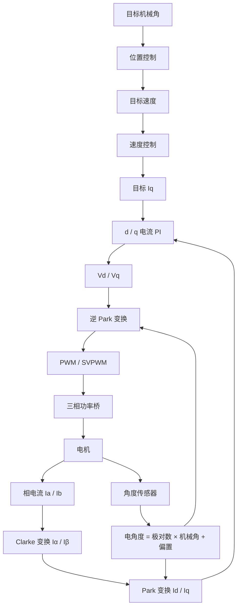

# FOC 学习与实现计划

## 实物目前能学到什么

老 GYEMS RMD-S 手册称系列采用 FOC 技术及位置、速度双闭环。实物板有 AS5600、三相栅极驱动器和功率桥，已完成位置与速度功能验证。较新 MS 协议写明无相电流采样，实物两台 0x9D 无回包，照片尚未找到明确采样链。因此目前能核实的是带编码器反馈的运动控制，V1.2.1 的 dq 电流闭环实现仍待查证。

AS5600 感受随轴转动的磁铁方向，输出 0～4095 的单圈计数。机械角结合极对数和电角度偏置才得到 FOC 用的电角度。V3 的 28 极数据不能直接作为 V1 的已验证参数。

## 带相电流反馈的 FOC 计算链

对于常见表贴永磁电机的基础控制，Id 目标通常设为 0，Iq 决定主要电磁转矩。PWM 调节绕组电压，电流 PI 根据实测电流与目标的差值反复修正输出。板上控制器按固定周期运行这条链，电脑串口用于命令和低频观测。

电压模式以转子角度计算 Vd/Vq 对应的三相电压，便于学习有传感器换相。加入相电流采样、偏置校正、同步 ADC 及 Id/Iq 调节后，可以验证完整电流闭环。

## 分阶段实验

1. 原装板读取 0x90 / 0x92，人工小角度拨动并核对方向、计数、零点及多圈连续性。已经完成一次 1299−2976 → −147.39° 的数值验证。
2. 原装板使用单次小角度 A4，记录角度与报告速度，观察位置、速度控制及异常折返。当前可直接使用 tools 中现有脚本。
3. 核实相电流能力。按信号路径寻找分流器、采样放大及 MCU ADC 输入。低侧两/三分流和单母线分流重建都可能实现采样，元件数量不足以单独判断。串口无电流返回也不足以证明内部完全无电流反馈。
4. 如采用外部可编程驱动，先把三相绕组与原功率板断开，核实外部驱动电压电流额定、绕组参数及角度传感器接口。先单台、卸去连杆进行低输出换相验证，测定 V1 极对数、方向及电角度零点。
5. 配置 ADC 电流采样时序、校正零偏与增益，验证 Ia+Ib+Ic 近似为零。实现 Clarke/Park 和 d/q 电流 PI，观察设定电流与实测电流的阶跃响应，再逐层加速度和位置控制。

后续新增的 FOC MCU 固件可放入 firmware。现有资料中没有可直接刷入 V1 原板的自主 FOC 固件。当前需要增加的能力是可编程 PWM/ADC、电流采样和已验证的角度反馈接入。

参考 [TI 有编码器 FOC 应用笔记](https://www.ti.com/lit/an/sprabq2/sprabq2.pdf)、[SimpleFOC 电压模式](https://docs.simplefoc.com/voltage_torque_mode) 和 [电流闭环实现](https://docs.simplefoc.com/torque_control_implementation)。
