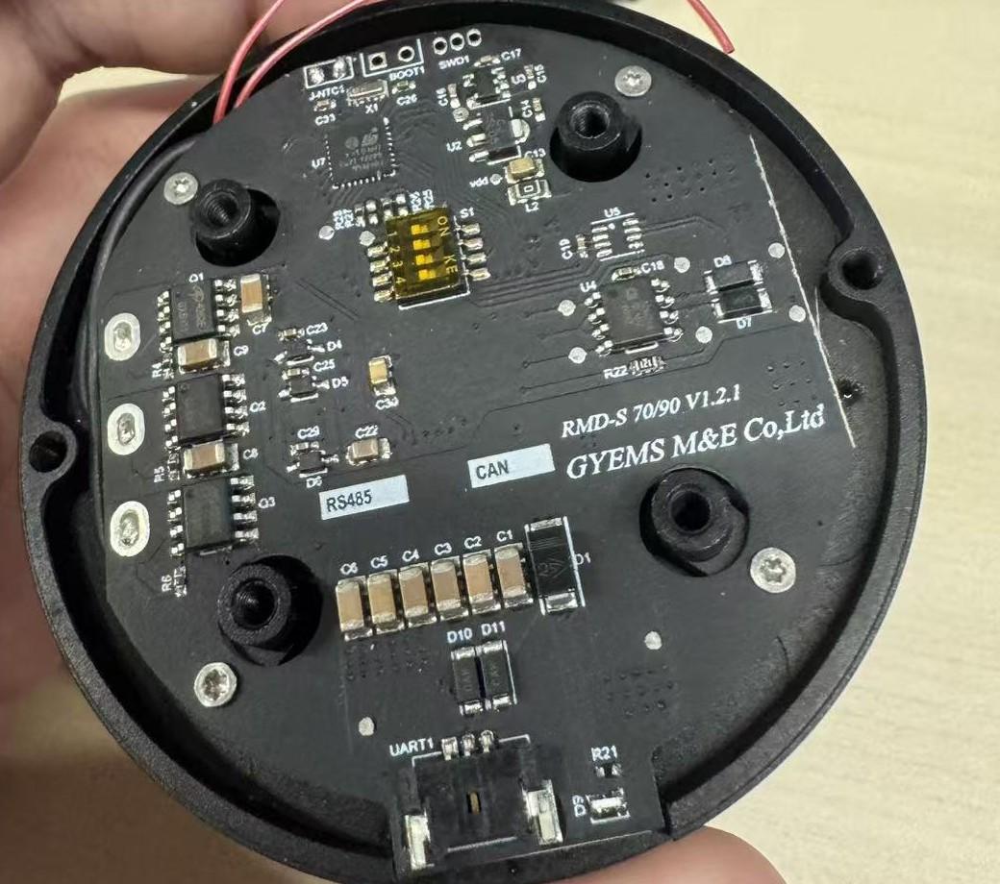
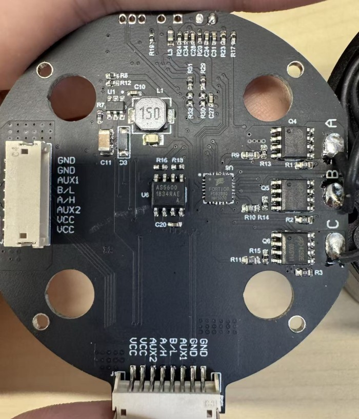

# 驱动板与结构文件

## MS7025 V1 实物照片

板号 RMD-S 70/90 V1.2.1。背面 U6 为 AS5600，中央芯片为 FD6288，右侧三焊点为 A/B/C。正背面的 Q1–Q6 支持三相功率桥结构，具体高低侧配对需追线。背面 R1–R3、R9–R11 的重复布局支持栅极驱动电阻的候选用途，未完成逐网确认。照片尚未识别到明确的相电流采样链。

FD6288 为栅极驱动器，其存在不能单独确认相电流反馈。电流采样需验证功率回路中的检测器件、模拟信号路径和控制器的实际使用。

两台板布局一致，当前照片来自 MS7025。hardware/mechanical 保存首版、同平面版和工作台固定版。SLDASM 引用对应目录内的 SLDPRT，保持目录结构后用 SolidWorks 打开。STL 对应当时设计尺寸，打印前按实物孔位、螺纹与有效旋入深度核对。

机械建模脚本为 SolidWorks COM 自动化，保留原目录相邻依赖和历史路径供复现检查。CAD 导出物可以直接查看，脚本执行需要 Windows、SolidWorks 和 Python COM 依赖。本次归档未重新运行 CAD 建模。
