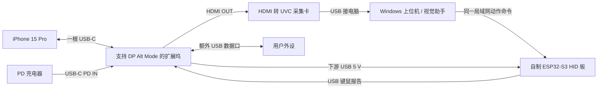

# iPhone 15 Pro 有线助手 · V1 设计草案

2026-11-18 · 原理图接线草案，供转绘到立创 EDA，待选型、ERC 和真机验证。

V1 自制 ESP32-S3-WROOM-1-N4R2 载板。扩展坞负责 DisplayPort Alt Mode 转 HDMI、PD 充电和 USB 扩展，采集卡把 HDMI 画面送给 Windows 电脑，电脑运行助手。ESP32 通过局域网接收动作，再以 USB HID 输出给 iPhone。[iPhone 15 Pro 规格](https://support.apple.com/zh-cn/111829) · [Glassbox 接线和助手软件](https://github.com/yoyicue/glassbox)

## 1. 整机接线与接口



- 手机端只接扩展坞上行口。HDMI 走视频，USB 2.0 走 HID，扩展坞处理充电所需的电源角色，iPhone 仍作为 USB 数据主机识别鼠标。
- 扩展坞至少有 HDMI、PD IN、两个 USB 数据口。一个 USB 数据口给载板，另一个留给用户。整机外壳至少露出 PD IN 和一个数据口。若采集模块内置，第三口可选第二个数据口，或给外接显示器独立分配 HDMI。
- 采集卡的 USB 线接电脑，采集卡的 HDMI 输入接扩展坞。首轮可用支持 1080p 的采集设备，记录实际可取帧的格式、分辨率和延迟。电脑和 ESP32 经路由器通信，手机画面与键鼠不依赖手机连 Wi-Fi。
- 自制扩展坞版从选定 PD 角色、DP Alt Mode 和 USB Hub 控制器开始。Benchport 可参考 PD 与 USB Hub 电路，Openterface 可参考 HDMI 采集电路，最终要在 iPhone 上验证组合行为。[立创 Benchport 工程](https://oshwlab.com/loicdaigle31/project_urejofry) · [Openterface 硬件](https://github.com/TechxArtisanStudio/Openterface_Mini-KVM_Hardware)

## 2. ESP32 载板原理图草案

`U1` 使用手头的 N4R2，4 MB Flash / 2 MB PSRAM。`J1` 是载板的 USB-C 母座，作为 USB 设备用 USB 数据线接扩展坞下游口。下面按网络画出可转绘的连线。`U2` 的具体型号、保护器件和去耦值需按选定器件手册确定。

### USB 与电源

```text
J1 USB-C 母座                                    U1 ESP32-S3-WROOM-1-N4R2
A6、B6 ─┬─ USB_DP ── R1 22 Ω ─────────────────── GPIO20 / USB_D+  (14)
        └─ 低电容 ESD ── GND
A7、B7 ─┬─ USB_DM ── R2 22 Ω ─────────────────── GPIO19 / USB_D−  (13)
        └─ 低电容 ESD ── GND
CC1(A5) ── R3 5.1 kΩ ── GND
CC2(B5) ── R4 5.1 kΩ ── GND
VBUS ── 输入保护/限流预留 ── U2 5 V → 3.3 V ──── 3V3 (2)
                                            ├── 100 nF ── GND
                                            └── 10 µF ─── GND
GND ─────────────────────────────────────────── GND (1, 40, EPAD 41)
```

- `CC1`、`CC2` 各自下拉，`SBU` 与 SuperSpeed 信号在本板留空。载板从扩展坞下游 USB 取 5 V，手机的 PD 充电由扩展坞承担。调试排针只接 3.3 V 电平的信号和地，避免 USB 与串口适配器同时给板子供电。
- 3.3 V 电源输出能力按至少 500 mA 选型，**实际 USB 取电要满足扩展坞端口的电流预算**。核对 USB 配置描述符、枚举前电流、插入瞬间浪涌和 Wi‑Fi 发射时的压降。任务固件可等 USB 配置完成后再启动 Wi‑Fi。U2 的输入、输出电容按器件手册选取，检查热耗散和稳定性。
- ESD 靠连接器，R1/R2 靠模组，USB 差分对按 90 Ω 目标与板厂叠层配合。可在模组端预留小电容焊位，首版不装。优先将板载天线伸出板边，并按手册保留净空，装入手机底部外壳后再测无线链路。

依据：[模组针脚与外围电路](https://documentation.espressif.com/esp32-s3-wroom-1_wroom-1u_datasheet_en.html) · [乐鑫原理图指南](https://docs.espressif.com/projects/esp-hardware-design-guidelines/en/latest/esp32s3/schematic-checklist.html) · [乐鑫布板指南](https://docs.espressif.com/projects/esp-hardware-design-guidelines/en/latest/esp32s3/pcb-layout-design.html) · [TI Type-C 设备端参考](https://www.ti.com/lit/wp/slyy109b/slyy109b.pdf)

### 复位、烧录与助手按键

```text
3V3 ── 10 kΩ ──┬── EN (3)          3V3 ── 10 kΩ ──┬── GPIO0 / BOOT (27)
               ├── 1 µF ── GND                    └── SW2 BOOT ── GND
               └── SW1 RESET ── GND

J2 调试焊盘                         GPIO4 (4) ──┬── SW3 STOP ── GND
U1 TXD0 (37) → 外部 UART RX                    └── 10 kΩ ── 3V3
U1 RXD0 (36) ← 外部 UART TX         GPIO5 (5) ── 1 kΩ ── LED ── GND
GND          ─ 外部 UART GND
```

EN 延迟以 10 kΩ / 1 µF 起步。STOP 低有效，由固件去抖并锁定为停止状态，直到手动重新启用。保留 5 V、3.3 V、EN、GPIO0 和 GND 测试点。转绘时按模组数据手册核对封装编号、EPAD 和天线禁布区，可在原理图页分为 `POWER`、`USB_HID` 和 `MCU_IO`。[乐鑫最小系统参考](https://docs.espressif.com/projects/esp-techpedia/en/latest/esp-friends/get-knowledge/esp32s3.html) · [模组数据手册](https://documentation.espressif.com/esp32-s3-wroom-1_wroom-1u_datasheet_en.html)

## 3. 固件和程序参考

| 部分 | 首版实现 | 参考代码 |
|---|---|---|
| ESP32 固件 | ESP-IDF + TinyUSB。先让按钮触发鼠标移动，再做鼠标和键盘复合设备。UART0 烧录和日志。4 MB Flash 先按单应用分区，内存使用按实测决定。 | [乐鑫 TinyUSB HID 示例](https://github.com/espressif/esp-idf/tree/master/examples/peripherals/usb/device/tusb_hid) |
| 动作通信 | Wi‑Fi STA，Windows 程序发送动作编号和参数。先实现状态、移动、点击、拖动、按键、停止。对单个控制端串行执行，超时后先查状态，避免重复点击。停止或断线时清队列并释放按键。 | [ESPMouseKey 的 TCP 协议](https://github.com/AlanRuir/ESPMouseKey) |
| 画面采集 | Windows 首轮用 OBS 验证 UVC 流，再用 Python/OpenCV 或 FFmpeg 取帧。固定竖屏，裁掉 HDMI 黑边，给帧标注编号和时间。 | [Glassbox 的画面与动作接口](https://github.com/yoyicue/glassbox) |
| 指针定位 | iPhone 打开辅助触控。先手动移动和点击，再做角落归零、固定速度和多点校准。根据新帧确认指针接近目标再点击。横竖屏或分辨率变化时使旧校准失效。 | [ESP32 iPhone Agent 的相对指针控制](https://github.com/onehumanbeing/esp32-iphone-agent/blob/main/hardware/hid_bridge/hid_bridge.ino) |
| 助手 | Python 程序先做读屏和单步点击。视觉模型返回受限动作，程序校验坐标与参数后发给载板，再取动作后的新帧判断是否成功。优先用“打开设置并进入蓝牙页面”做演示。 | [Glassbox](https://github.com/yoyicue/glassbox) · [Aico Link 的采集与 Agent 架构](https://github.com/AidenAI-IO/aico-link) |

首版用 Python 重新实现取帧与动作接口，同时保留未来更换采集后端的能力。若改用 Glassbox 的执行流程，需要把它的 PicoKVM 动作接口适配到 ESP32 的协议，并将其绝对坐标转换为本项目的相对鼠标动作。

## 4. 验收顺序

1. **扩展坞联通**。用 HDMI 显示器、普通 USB 鼠标、PD 充电器及另一件 USB 外设验证四项同时工作，记录扩展坞型号、iOS 版本和连接顺序。
2. **载板上电**。用电脑先确认 3.3 V、EN 时序、UART 烧录和原生 USB 枚举，再接入 iPhone。验证鼠标移动、点击、拖动和英文输入，测 Wi‑Fi 启动时的供电稳定性。
3. **画面与 PD**。更换成采集卡，开始持续取帧。在 HDMI 和 HID 同时工作时插拔 PD，记录是否重新枚举、视频是否重连、额外数据口是否正常。
4. **助手闭环**。先用人工选点验证 9 个位置，再由模型完成单步任务。记录截图坐标、实际指针落点、帧延迟和动作结果。按 STOP 后验证无后续点击，断线恢复后先重新取帧再开始。

以上四项通过后，再决定是否将扩展坞、高速视频电路和采集模块整合到同一块 PCB。整合前固定原型实测的 PD 供电预算、视频模式与外部端口数量。
