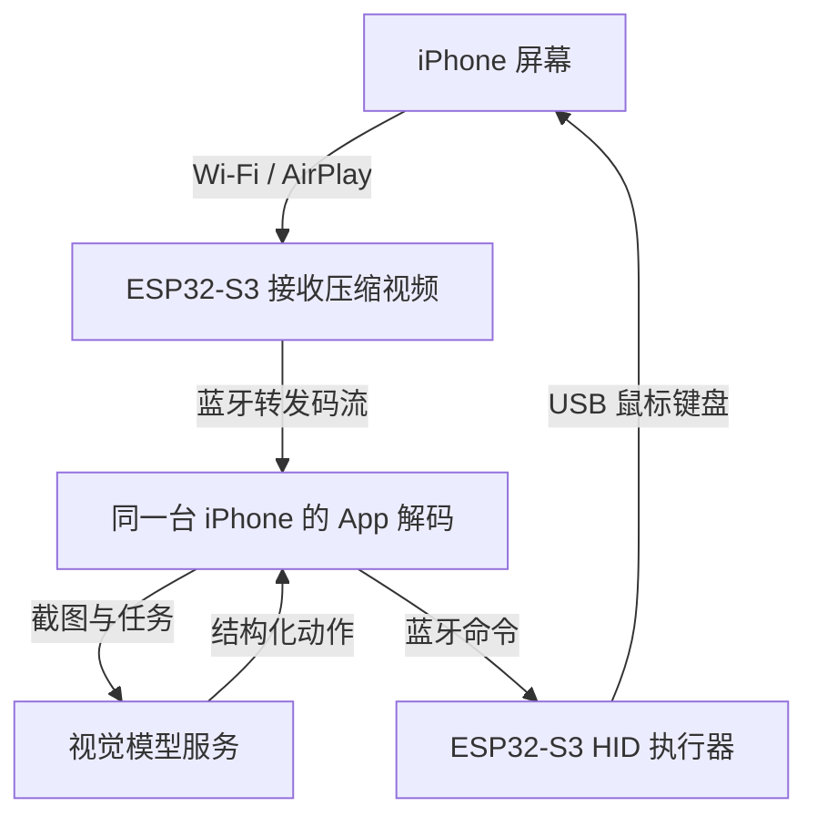

# ESP32-S3 手机 AI 控制项目计划报告

日期：2026-11-05

状态：**准备开始**

实施方式：本人独立完成，开源方案作为参考。

## 1. 目标与当前边界

制作一套连接本人 iPhone 的控制装置，使视觉模型能够观察手机画面，并通过外部键盘鼠标输入执行简单任务。目标运行形态为手机加开发板；开发、烧录、App 编译和调试阶段允许使用电脑。模型推理可使用远程服务，运行时不接电脑不等于模型离线运行。

本报告是初步实施计划。手机型号、开发板、开发环境、依赖版本和实际兼容性均待确认；所有阶段尚未开始，不能将参考项目演示视为本项目成果。

## 2. 参考依据与技术判断

主要参考 [ESP32 iPhone Agent by Henry Yuan](https://github.com/onehumanbeing/esp32-iphone-agent)，优先阅读其 [中文说明](https://github.com/onehumanbeing/esp32-iphone-agent/blob/main/README.zh-CN.md)、[蓝牙协议](https://github.com/onehumanbeing/esp32-iphone-agent/blob/main/docs/ble-protocol.md)及硬件、iOS 源码。

参考项目的当前路线由板子接收 AirPlay 并转发码流，手机 App 解码、调用模型和产生动作，板子再输出 USB HID。旧版依赖电脑服务，研究时必须区分版本。开始实施前记录参考提交 SHA、获取日期和选用模块，避免主分支变化影响复现。

USB HID 只提供输入，不能读取屏幕。难点是将图像、指针位置和实际操作连接成可验证闭环。以下架构为拟实现设计，须逐层实测。

## 3. 系统架构

| 模块 | 计划职责 | 必须确认的接口 |
|---|---|---|
| ESP32-S3 固件 | 热点、AirPlay 接收、视频转发、HID 输出 | USB 枚举、BLE 分包、缓冲、动作确认 |
| iPhone App | 连接引导、解码、模型调用、执行状态与停止 | 帧重组、超时、App 生命周期、状态同步 |
| 模型适配层 | 输入画面与任务，输出受约束动作 | 参数校验、坐标范围、步数及调用预算 |
| 指针校准层 | 画面坐标到相对鼠标移动的转换 | 分辨率、方向、加速度、归零与误差修正 |

App 必须区分“命令收到”“输入已发出”和“画面确认成功”，不以模型声称完成作为唯一成功依据。

## 4. 开始前确认清单

- iPhone 型号、iOS 版本、USB-C 或 Lightning 接口。
- Mac 与 Xcode 是否可用，App 安装、签名及长期使用方案。
- ESP32-S3 原生 USB 接口、PSRAM、供电与引脚条件。
- 模型服务的图像输入、网络可达性、延迟和使用成本。
- 手机连接板子热点后，蜂窝数据访问模型服务是否正常。
- AssistiveTouch 和鼠标键盘兼容性。

优先评估参考项目使用的 XIAO ESP32S3 普通版；替代开发板须检查原生 USB 与内存配置，不能只看 USB-C 外形。Lightning 转接、电源和边充边用能力单独验证，不预设任意扩展坞都可用。第一阶段不设计定制 PCB。

## 5. 实施阶段与验收

各阶段按验收推进，暂不承诺日历工期。

| 阶段 | 工作内容 | 输出与通过条件 |
|---|---|---|
| P0 条件与版本确认 | 检查设备、开发工具、参考版本和许可证 | 保存设备清单、依赖版本与参考 SHA；确定可运行的最小组合 |
| P1 USB 输入 | 枚举鼠标键盘，手动发送移动、点击、拖动和英文输入 | 真机完成上述动作；停止后释放所有按下状态；保存日志与视频 |
| P2 画面通道 | 热点、AirPlay 接收、BLE 分包、App 解码 | App 连续显示当前画面，记录分辨率、帧率、延迟和丢帧；中断可识别 |
| P3 手动闭环 | 从 App 发动作，观察新画面，完成校准 | 固定竖屏下连续点击多个目标；记录误差，不把相对移动当作像素绝对定位 |
| P4 AI 单步闭环 | 截图→模型→参数校验→执行→等待→复核 | 完成一次低风险任务；保存每步画面、动作、耗时和实际结果 |
| P5 连续任务与恢复 | 超时、停止、断线、镜像停止、模型异常处理 | 异常时暂停并释放输入；恢复后先取新画面再决定是否重试 |
| P6 整理与复现 | 清理工程、版本说明、安装文档和验收报告 | 按文档重新构建与部署；形成真实功能清单与已知问题 |

建议先测试打开设置、进入指定页面、创建测试闹钟等可撤销任务。每项连续尝试 5 次，逐次记录成功、失败与人工干预；不能只保留成功演示。

## 6. 最小功能与后续范围

首版只处理固定竖屏方向、鼠标移动/点击/拖动、ASCII 键盘输入和逐动作画面复核。中文输入、多指缩放、横屏、后台长时间运行、边充边用、定制 PCB 和低延迟视频优化在基本闭环通过后再排期。

动作协议至少包含动作编号、类型、参数、执行结果和超时；停止应释放按键及鼠标按钮。避免因网络重试重复点击，恢复时先核对动作编号与当前画面。API 密钥放入系统安全存储，不提交仓库；实际使用截图是否留存由本人决定。

## 7. 风险与验证办法

| 风险 | 对策及待验证项 |
|---|---|
| AirPlay 兼容性和视频带宽 | 先跑通低分辨率取帧；测 BLE 吞吐、画面新鲜度及丢帧恢复 |
| Wi-Fi/蓝牙同时运行竞争资源 | 分别测单通道和并发稳定性，再调整缓冲与传输频率 |
| 相对鼠标漂移与坐标误差 | 固定方向和设置，归零、校准并用画面确认焦点 |
| App 切到其他应用后的生命周期 | 尽早做真机连续运行测试，不假设后台行为稳定 |
| 手机热点占用 Wi-Fi | 验证蜂窝网络和模型端点；记录断网时的暂停行为 |
| 锁屏及受保护画面不可见 | 画面失效时暂停，解锁并重新建立镜像后再继续 |
| 模型误判或操作没有生效 | 限制单步动作，使用新画面复核，保留人工停止入口 |
| 上游版本或依赖变化 | 固定版本并记录构建参数，再单独评估升级 |

## 8. 文档与仓库维护

当前只提交本项目 README、计划报告及仓库首页入口。开发后逐步增加 `firmware/`、`hardware/`、`docs/`，不改动其他项目目录。

建议后续保留：硬件清单、连接图、依赖版本表、烧录及签名步骤、协议说明、校准方法、测试记录与问题日志。README 状态按真实进度更新：准备开始 → 基础验证中 → 原型开发中 → 真机验证中 → 可复现版本。

## 9. 来源与许可证

本次仅编写原创计划文档，不复制参考源码。后续复用时保留原作者版权及所需声明，并公开标注 [ESP32 iPhone Agent by Henry Yuan](https://github.com/onehumanbeing/esp32-iphone-agent)。

参考仓库 [LICENSE](https://github.com/onehumanbeing/esp32-iphone-agent/blob/main/LICENSE) 为 MIT，但其 [AirPlay 子目录](https://github.com/onehumanbeing/esp32-iphone-agent/tree/main/hardware/hid_bridge/src/airplay) 使用 GPL-3.0；分发链接该部分的固件时，应核对并履行对应源码和许可义务。具体以实施时固定版本的文件为准，不把整个工程统一标成 MIT。

## 10. 当前下一步

确认手机、Mac 和开发板条件，固定参考版本，然后仅开展 P1 的 USB HID 手动验证。待输入和画面两条通道分别通过后再接入 AI。
